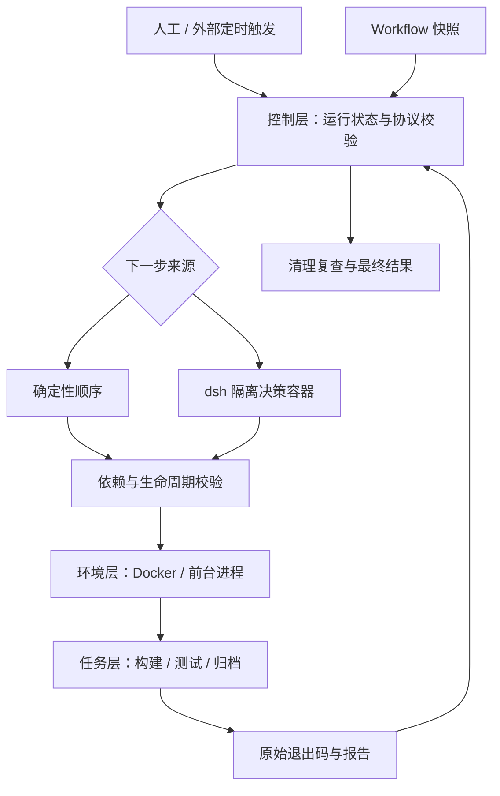

# Workflow 执行与可信结果设计

## 职责

| 层 | 职责 | 实现 |
| --- | --- | --- |
| 控制 | 接受触发、读取 Workflow、决定或接受下一步建议、管理状态 | cli.mjs、lib/state.mjs、lib/dsh.mjs |
| 环境 | 启动进程/容器、超时终止、资源回收 | adapters.mjs |
| 任务 | 构建、测试、输出原始报告 | tasks/ |

Agent 可选择下一步或请求有限日志，但无权直接写宿主运行记录。
这是受约束的步骤编排，不是允许 Agent 自由执行任意宿主命令。
脚本与 Agent 共用依赖校验、执行器和最终判定。

## 状态与结果

一个运行只由一个控制器写状态。开始前取得同 runsDir/resourceKey 的独占文件锁。
步骤处于 running、succeeded、failed、incomplete 或 skipped。
needs 是成功依赖，after 是完成依赖。依赖尚未结束时拒绝调用，依赖失败时记录合法跳过。
重复、乱序或未知步骤记为持久违规，最终退出 3，不能通过后来补跑洗掉。

Workflow 在启动时校验并快照。最终结果遍历快照中的全部步骤，不能只检查固定三个名字。
有效报告要求计数自洽且有实际执行；全跳过、无报告或异常退出均不变成绿灯。
本地文件不是防宿主管理员篡改的安全审计存储，任务本身也必须可信。

任务产物位于 output/，控制记录位于父目录，Docker 任务不获得父目录写权限。
最终退出优先级为编排错误 3、运行不完整 2、已确认测试失败 1、成功 0。
清理剩余或无法核验属于不完整；原始步骤退出码和报告仍保留。

## 异常与清理

子进程使用异步 spawn，正常信号可进入停止处理。Linux 终止受控进程组，
Windows 使用 taskkill /T /F 并设直接终止兜底。
Docker 采用 create → start → inspect，区分启动故障与容器内命令退出。
所有任务容器和决策容器带 run_id 标签；最终删除并重新查询确认。

强制终止控制器时可能留下容器和锁。这种情况必须执行 cleanup，不能宣称自动清理必然发生。
PID 可能复用，恢复入口因此采用保守拒绝策略，必要时由运维确认占用者。
process 适配器不追踪任务主动后台化后的任意外部进程；生产优先使用容器/平台资源边界。
跨机器锁、Pod TTL、节点失联恢复需要目标平台实现，本次未实现。

## 配置和路径

默认配置从 CLI 安装位置读取。显式 --config 相对调用者目录解析。
任务脚本、工作目录、Workflow、结果目录与挂载源均相对配置目录解析。
宿主挂载源保留宿主平台路径，容器内使用 /task.sh 和 /out；不能把 Windows 源路径盲目转为 Linux 路径。
Docker bind 路径中含逗号或双引号会明确拒绝，避免参数被误解析。
输出目录必须可写；只读源码可通过 mounts 提供，不要求源码目录可写。
只改配置能替换已有适配器和任务；新增平台生命周期仍需适配代码。

## dsh 迁移

旧版让宿主 dsh 执行 node cli.mjs step。新版禁止该入口执行任务，调用返回 3。
dsh.command 改为镜像内命令数组，新增 dsh.image。
不再使用宿主 dsh.args 或本机可执行文件路径。
每次决策传入 Workflow、步骤状态和可选有限日志，输出单行 JSON：
run + step、tail + step 或 finish。控制器永远保留执行和判定权。

决策容器使用只读根目录、临时 /tmp、去能力、禁止提权，不挂载宿主数据或 Docker socket。
这限制文件访问，但不是网络数据防泄漏方案；模型接口访问需要独立网络策略。
Agent 输入可能包含敏感日志，实际任务必须另做脱敏。模型密钥仅通过指定环境变量注入。
日志限制降低上下文膨胀，完整日志磁盘保留仍需外部保留期与配额。

协议模拟已验证；真实 dsh 镜像参数、模型接入及 Web UI 仍是待验收项。
