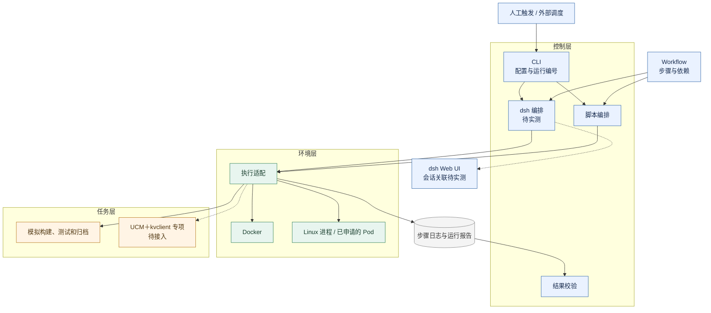

# 推理服务回归测试框架设计

## 1. 目标与现状

将推理服务的构建、启动、请求验证和结果归档整理为可复用的执行流程。首个目标场景是 UCM＋kvclient 每日功能看护。使用者可以先用模拟任务熟悉流程，再通过配置选择执行环境和任务入口。

| 能力 | 状态 |
| --- | --- |
| 脚本编排与 Docker 执行 | 本机已验证正常、构建失败、报告缺失、大日志和步骤超时 |
| dsh 分步骤编排 | 已提供入口，真实 dsh 分支行为和 Web UI 追踪待验证 |
| Linux 进程适配 | 已提供入口，迁入 Genet Pod 待验证 |
| UCM＋kvclient 专项 | 早期原型验证过模拟后端读写。专项任务尚未接入本仓库，真实推理缓存链路待验收 |

## 2. 架构

Workflow 定义步骤顺序及依赖关系。控制层选择下一步，环境层启动进程或容器，任务层执行具体操作。各层以运行编号关联日志、步骤记录和最终报告。

蓝色为控制层，绿色为环境层，橙色为任务层，灰色为共享运行记录。

| 文件 | 职责 |
| --- | --- |
| [cli.mjs](../cli.mjs) | 读取配置、发起运行、调用步骤、记录并校验结果 |
| [workflow.json](../workflow.json) | 定义 `build`、`test`、`archive` 的顺序与依赖 |
| [adapters.mjs](../adapters.mjs) | 启动 Docker 或 Linux 进程，保存日志，检查并清理 Docker 容器 |
| [tasks/mock.sh](../tasks/mock.sh) | 提供可复现的模拟任务与故障输入 |
| [config.json](../config.json) | 设置镜像、适配器、任务脚本和超时 |

## 3. 编排与任务接口

脚本模式按 Workflow 顺序检查依赖并调用步骤。dsh 模式把 Workflow 的步骤及依赖传给 dsh，由 dsh 选择并逐次调用 `node cli.mjs step <run_id> <step>`。两个入口运行同一任务脚本。最终校验检查实际步骤记录，dsh 摘要用于查看运行经过。

任务脚本接收步骤名和场景名，通过 `RUN_OUTPUT` 获取共享结果目录。构建产物或测试输入需写入共享目录，供后续容器读取。退出码记录步骤执行结果。测试步骤另写 `test-report.json`，其中 `checked`、`passed`、`failed` 为整数，执行数大于零且等于通过数加失败数。首版最终校验以三个固定步骤为准，增加步骤时应同步明确依赖和最终判定规则。

Docker 为每个步骤启动独立容器，挂载只读任务脚本和可写输出目录，使用本地镜像并关闭容器网络。真实引擎和请求测试需要在同一生命周期内运行，或显式提供可达服务、共享工作区和资源清理方式。Linux 进程适配可用于已申请的 Pod，Genet 的资源申请和回收接口留待实际接入。

## 4. 配置与日志

配置优先级为环境变量、配置文件、内置默认值。当前支持 `REGRESSION_ADAPTER`、`REGRESSION_IMAGE` 和 `REGRESSION_TIMEOUT_MS` 覆盖对应字段。换任务时修改 `taskScript`。模型路径、设备参数和后端配置随专项任务接入，并由运行环境提供。运行配置会写入 manifest，凭据通过执行环境注入。

每次运行在 `runs/<run_id>/` 下保留：

| 文件 | 用途 |
| --- | --- |
| `manifest.json` | 运行编号、编排模式、场景及生效配置 |
| `build.json` 等步骤记录 | 开始时间、结束时间、退出码与执行错误 |
| `build.log` 等日志 | 直接写入的 stdout 和 stderr |
| `test-report.json` | 原始测试统计 |
| `dsh.log` | dsh 模式的输出 |
| `result.json` | 最终状态、步骤结果和清理记录 |
| `recovery.json` | 手动清理命令的结果 |

dsh 默认收到简短步骤记录。排查时用 `node cli.mjs tail <run_id> <step>` 查看日志末尾，最多读取 4 KiB、返回 50 行。该预览是调用约定，模型进程的文件访问仍取决于执行权限。Genet 验收时检查能否用运行编号或会话映射串起 dsh 调用、Pod 日志与最终报告。

## 5. 失败处理与清理

| 场景 | 结果 |
| --- | --- |
| 构建、测试及归档完成，报告有效且无失败 | `passed`，退出 0 |
| 构建返回非零，跳过测试并完成归档 | `failed`，退出 1 |
| 报告缺失、零用例、步骤超时或编排未完成 | `incomplete`，退出 2 |
| 实际步骤违反已检查的顺序或依赖 | `workflow_error`，退出 3 |

Docker 资源按运行编号打标签。外层收尾时检查并清理同一次运行的容器，再查询剩余资源。清理结果独立记录为 `clean`、`remaining` 或 `unverified`。外层进程被强制终止后，可在确认该运行已停止后执行 `node cli.mjs cleanup <run_id>`。Pod 回收和真实 dsh 中断仍需实测。

## 6. 验证与扩展

1. **本机复现。** 按 [README](../README.md) 跑正常、构建失败和报告缺失。构建失败时核对退出码为 7、测试未启动、归档完成。
2. **dsh 对照。** 使用同一配置和故障输入切换到 dsh。核对实际步骤、分支决策、最终状态，并记录耗时和人工介入。
3. **Genet 迁移。** 在已申请的 Pod 上运行固定版本，验证入口可执行、报告可持久化、资源可回收。
4. **UCM 专项验收。** 在支持的引擎、设备和后端组合上发起请求，用 kvclient 侧日志、指标或断言证明缓存写入、命中和回读，并核对推理结果。测试需控制引擎自身缓存的影响。
5. **每日看护。** 固定本次源码提交和制品身份，接入外部调度、持久化归档和失败通知。真实用例稳定后，以同一入口扩展其他引擎和环境。

复用已有任务时，改配置即可切换镜像和超时。新增引擎、缓存后端或资源平台时，补充任务或适配逻辑。复用验收由另一位使用者按 README 独立跑通成功和失败用例，并从运行编号找到原始日志和报告。
